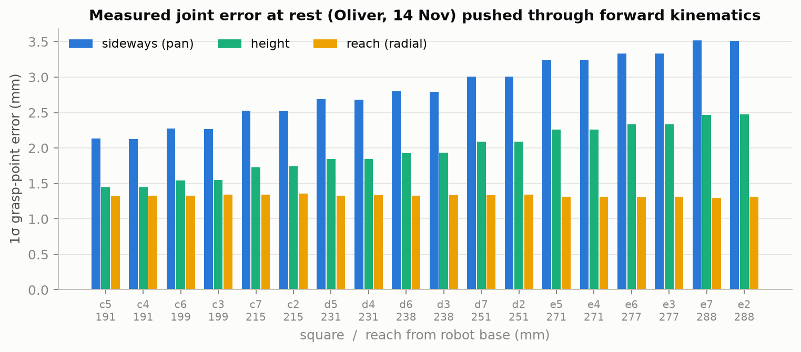
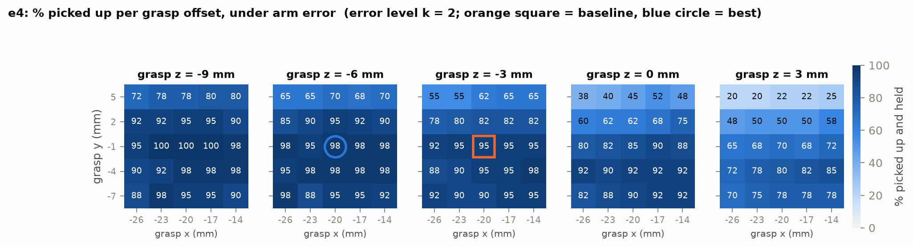
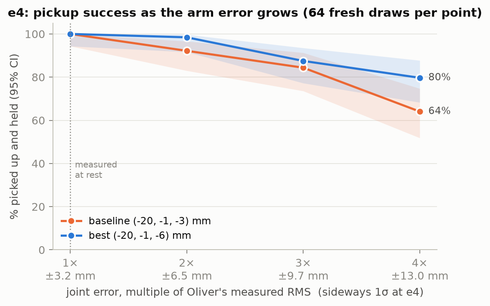
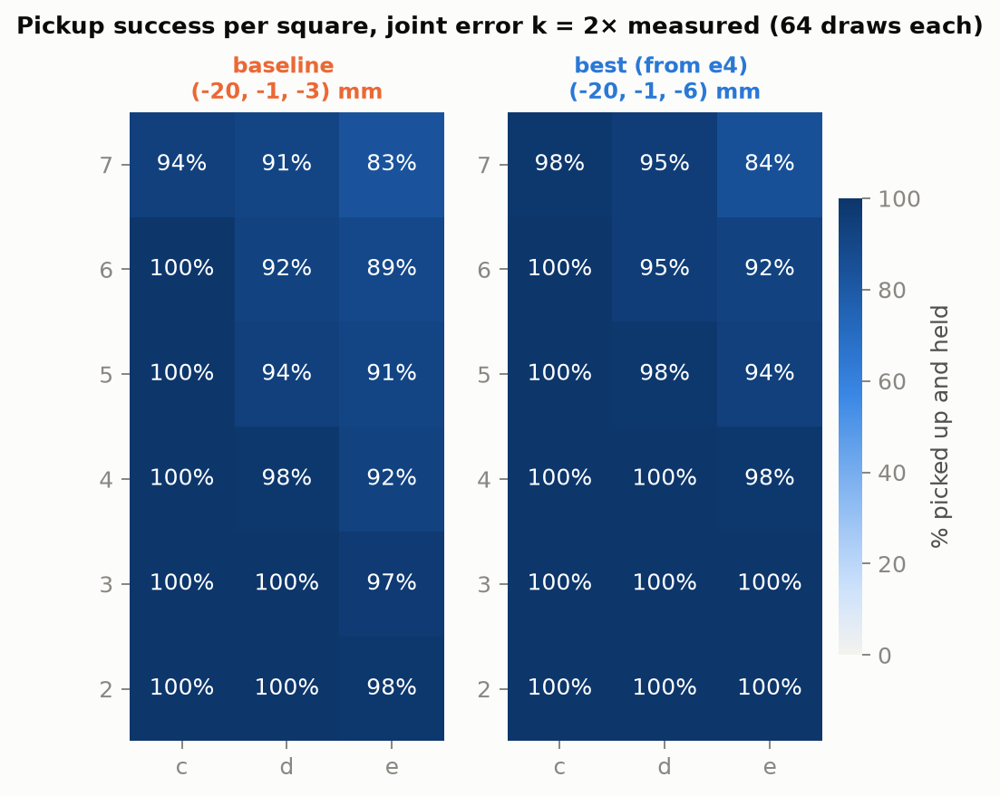
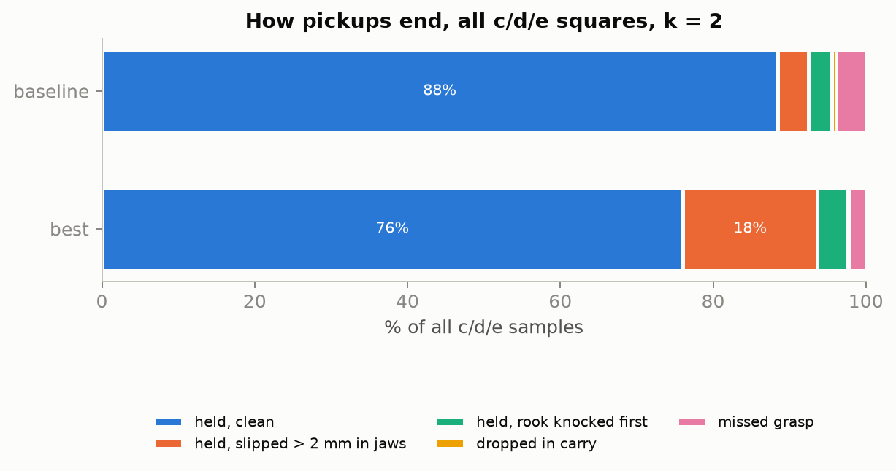
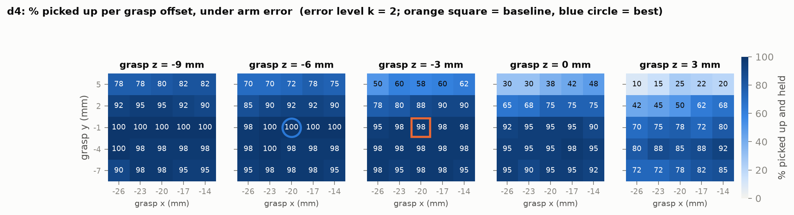

# Pickup tolerance to arm error: c, d, e files (sim)

_Auto-generated by `lowlevel/drafts/pickup_tolerance_report.py`. Each `##` section is one slide: the heading is the claim, then one figure and up to three bullets._

## Summary

- **Question.** Oliver's real arm misses its joint targets by 0.2–0.8° RMS when it has stopped at the grasp. Does the rook still get picked up, and which grasp offset gives the most margin? Pickup success only; place accuracy is not scored.
- **Arm error at the grasp point** (FK of the measured joint error, 1σ): sideways 2.1–3.5 mm (almost all shoulder pan), height 1.4–2.5 mm, reach 1.3–1.4 mm. Errors grow with reach (e file > d > c).
- **Best grasp at e4** (search, k = 2, i.e. twice the measured error): (-20, -1, -6) mm: 39/40 held, vs baseline (-20, -1, -3) mm: 38/40.
- **e4 success vs error size** (fresh draws): baseline 1×: 100%, 2×: 92%, 3×: 84%, 4×: 64%; best 1×: 100%, 2×: 98%, 3×: 88%, 4×: 80%.
- **c/d/e ranks 2–7, k = 1**: baseline 100% held (worst e7 98%); best 100% (worst e7 98%) over 18 squares.
- **c/d/e ranks 2–7, k = 2**: baseline 95% held (worst e7 83%); best 98% (worst e7 84%) over 18 squares.

## Takeaways

- **k = 1** (1152 paired pickups over 18 squares): held by baseline only 0, by the lower grasp only 0 (sign test p = 1). Clean grasps: baseline 99%, lower grasp 85%.
- **k = 2** (1152 paired pickups over 18 squares): held by baseline only 1, by the lower grasp only 25 (sign test p = 8e-07). Clean grasps: baseline 88%, lower grasp 76%.
- **At the error Oliver measured (1×), the sim picks the rook up almost every time with either grasp.** The real-arm failure rate on 7 Nov (26% compensated, 42% baseline) is much higher, so most real failures come from things this error model leaves out: board/camera calibration (13 mm, 3° on 14 Nov), arm lag at the moment the jaws close, and the sim-to-real gap.
- **Margin is what the lower grasp buys.** Gripping 3 mm lower holds more often once the error doubles (e4 at 4×: see the scale curve). It costs cleanliness: the rook slips > 2 mm in the jaws more often. That does not lose the piece, but may matter for placing.
- **The e file and rank 7 are weakest** (longest reach, so the largest pan error). c is near-perfect.

## What is different from previous weeks

- **Before (Oct to 7 Nov):** the robot was given a *wrong rook position* (blind mode, σ = 3.3 mm) and we scored *where the rook landed* (≤ 5 mm), then tuned place offsets. The arm itself was assumed perfect.
- **Last pilot (10 Nov):** known mode, so the arm aimed at the true position. The start grid therefore never created a gripper-to-rook error, and 54 of 81 grasps scored 100%. That cannot rank grasps, and z was never varied.
- **Now:** the planner aims at the true position, and the *simulated arm is driven with joint errors* drawn from Oliver's hardware measurements (`run_sim_move(joint_offset_deg=…)`). This gives position, height and gripper-angle error together, in the same proportions as the real arm. The score is **pickup only** (lifted and held through the carry). The grasp search now varies height (z) as well as x/y, and every grasp sees the same error draws, so comparisons are paired.

## The arm's error at the grasp is 1–3.5 mm (1σ), and mostly sideways

- Oliver's measured joint error at rest, at the end of the grasp hold, RMS (pan / lift / elbow / wrist flex / wrist roll): 0.80 / 0.62 / 0.22 / 0.27 / 0.70°. It was pushed through the arm's forward kinematics at each square's planned grasp pose.
- Shoulder pan dominates: about 3–4 mm sideways per degree, growing with reach. Lift and elbow set the height error.
- Tracking error *during motion* is much larger (e4: 10 / 6 / 14 mm reach / sideways / height). It matters only if the jaws close before the arm settles, so the sweep tests up to 4× the at-rest error.

## Best grasp at e4: (-20, -1, -6) mm

- 125 grasp offsets × 40 arm-error draws at k = 2 (twice the measured error). Every grasp sees the same draws and rook starts. Picked by held rate smoothed over the grasp and its 6 grid neighbours (one sample = 2.5%, so the raw count alone is noise).
- Best (-20, -1, -6) mm: 39/40 held, 25/40 clean. Baseline: 38/40 held, 33/40 clean.
- Top 5: (-20, -1, -6) mm 39/40; (-20, -4, -6) mm 39/40; (-17, -4, -6) mm 39/40; (-17, -1, -6) mm 39/40; (-23, -1, -6) mm 38/40.

## How much arm error the pickup tolerates (e4)

- Baseline: ≥ 95% held up to 1× the measured error.
- Best: ≥ 95% held up to 2× the measured error.
- New random draws (seed 1), independent of the search, so the best grasp is not scored on the draws it was chosen on.

## Across the c, d and e files

- 64 arm-error draws per square and grasp, with random rook starts within ±16 mm of the square centre. Each grasp is carried one rank forward (rank 7 back).
- k = 1: baseline 100%, best 100%; weakest square e7.
- k = 2: baseline 95%, best 98%; weakest square e7.
- k = 1 board: `fig4_board_k1.png`.

## How the misses happen

- Baseline: held, clean 88%, held, slipped > 2 mm in jaws 4%, held, rook knocked first 3%, dropped in carry 1%, missed grasp 4%.
- Best: held, clean 76%, held, slipped > 2 mm in jaws 18%, held, rook knocked first 4%, dropped in carry 0%, missed grasp 2%.
- 'Slipped' and 'knocked' still count as picked up. They are early warnings: the rook moved in the jaws, or was nudged before the jaws closed.

## Does the e4 optimum carry over to d4?

- d4's own best: (-20, -1, -6) mm, 40/40 held. The e4 best at d4: 40/40. Baseline at d4: 39/40.

## Caveats and next steps

- Sim only. The hardware moves 1.9× slower than planned and lags 51–122 ms. If the jaws close before the arm settles, the error at closing is larger than the at-rest figure. Ask Oliver for hardware − plan at the *close command*.
- Camera and board calibration error is not included (board about 13 mm and 3° off on 14 Nov). It shares the same tolerance budget, so the margin here is an upper limit on what calibration may use.
- Joint errors are drawn independently. Gravity sag couples lift, elbow and wrist on the real arm.
- Next: validate the best grasp on hardware at d4 and e4 against baseline (paired, as on 7 Nov). Then extend to the b file, and leave f, g and h for last.

## Files

- Runs: `e4_search/`, `e4_scale/`, `squares/<sq>/`, `d4_search/` (`results.jsonl`, one line per simulated pickup). FK: `fk_bound/`.
- Code: `lowlevel/drafts/run_pickup_tolerance.py`, `run_pickup_tolerance_cde.sh`, `joint_error_fk_bound.py`, `pickup_tolerance_select.py`, `pickup_tolerance_report.py`. Sim hook: `multisim_chess_fast.run_sim_move(joint_offset_deg=…)`.
